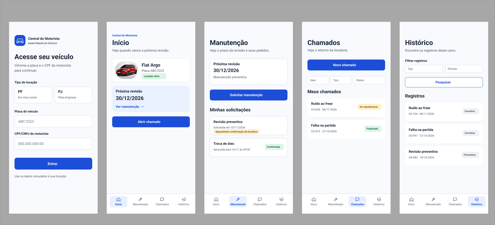
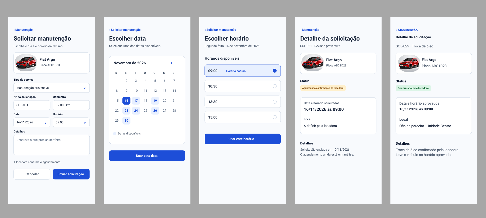
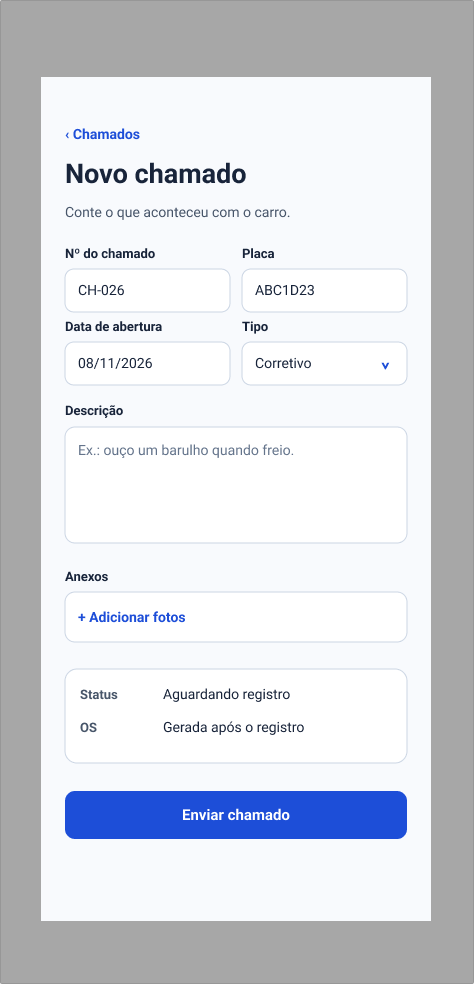
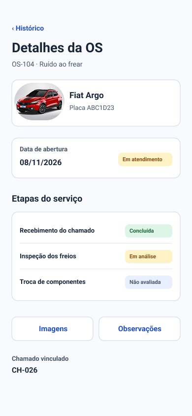

1) **Avaliação de IHC através de inspeção HEURÍSTICA \[1 solução completa por pessoa da equipe \- todas as telas do projeto\]**

> **_NOTE:_**: SOMENTE VIOLAÇÕES

Dez Heurísticas de Nielsen

**Descrição da avaliação**

Avaliação heurística, definida por Nielsen e Molich (1994), é um método de avaliação de usabilidade onde um avaliador procura problemas de usabilidade numa interface com o usuário através da análise e interpretação de um conjunto de princípios ou heurísticas. Este método de avaliação é baseado no julgamento do avaliador.

1\. Primeiramente, leia e analise as dez heurísticas (ver Tabela 1).

**Tabela 1 \- Conjunto de heurísticas de Nielsen (1994)**

| 1\. | Visibilidade do status do sistema: |
| :---- | :---- |
| O sistema deve sempre manter os usuários informados sobre o que está acontecendo através de feedback apropriado, em um tempo razoável. |  |
| **2\.** | **Compatibilidade entre sistema e mundo real:** |
| O sistema deve utilizar a linguagem do usuário, com palavras, frases e conceitos familiares para ele, ao invés de termos específicos de sistemas. Seguir convenções do mundo real, fazendo com que a informação apareça em uma ordem lógica e natural. |  |
| **3\.** | **Controle e liberdade para o usuário:** |
| Estão relacionados à situação em que os usuários frequentemente escolhem as funções do sistema por engano e então necessitam de "uma saída de emergência” claramente definida para sair do estado não desejado sem ter que percorrer um longo diálogo, ou seja, é necessário suporte a *undo* e *redo*. |  |
| **4\.** | **Consistência e padrões:** |
| Referem-se ao fato de que os usuários não deveriam ter acesso a diferentes situações, palavras ou ações representando a mesma coisa. A interface deve ter convenções não-ambíguas. |  |
| **5\.** | **Prevenção de erros:** |
| Os erros são as principais fontes de frustração, ineficiência e ineficácia durante a utilização do sistema. |  |
| **6\.** |  **Reconhecimento em lugar de lembrança:** |
| Tornar objetos, ações, opções visíveis e coerentes. O usuário não deve ter que lembrar informações de uma parte do diálogo para outra. Instruções para o uso do sistema devem estar visíveis ou facilmente acessíveis. |  |
| **7\.** | **Flexibilidade e eficiência de uso:** |
| A ineficiência nas tarefas pode reduzir a eficácia do usuário e causar-lhes frustração. O sistema deve ser adequado tanto para usuários inexperientes quanto para usuários experientes. |  |
| **8\.** | **Projeto minimalista e estético:** |
| Os diálogos não devem conter informações irrelevantes ou raramente necessárias. Cada unidade extra de informação em um diálogo compete com unidades relevantes e diminui sua visibilidade relativa. |  |
| **9\.** | **Auxiliar os usuários a reconhecer, diagnosticar e recuperar erros:** |
| Mensagens de erro devem ser expressas em linguagem natural (sem códigos), indicando precisamente o erro e sugerindo uma solução. |  |
| **10\.** | **Ajuda e documentação:** |
| Mesmo que seja melhor que o sistema possa ser usado sem documentação, pode ser necessário fornecer ajuda e documentação. Tais informações devem ser fáceis de encontrar, ser centradas na tarefa do usuário, listar passos concretos a serem seguidos e não ser muito grandes. A ajuda deve estar facilmente acessível e on-line. |  |

2\. A seguir, avalie o sistema procurando possíveis problemas de usabilidade.   
3\. Quando um problema qualquer for detectado, classifique-o em uma das dez heurísticas de Nielsen, anotando o problema na tabela correspondente e atribuindo o **grau de severidade** (0 até 4\) para este problema (dado pela tabela 2\) e recomece novamente até não encontrar mais problemas de usabilidade.

**Tabela 2 \- Grau de severidade dos problemas de usabilidade**

| Grau de severidade | Tipo | Descrição |
| ----- | :---- | :---- |
| 0 | Sem importância | Não afeta a operação da interface |
| 1 | Cosmético | Não há necessidade imediata de solução |
| 2 | Simples | Problema de baixa prioridade (pode ser reparado) |
| 3 | Grave | Problema de alta prioridade (deve ser reparado) |
| 4 | Catastrófico | Muito grave, deve ser reparado de qualquer forma. |

**Declaração de violações**

| ID | Tela e ação | Heurística | O que observei e por que importa | Tipo | Severidade | Ajuste que proponho | Evidência |
| --- | --- | --- | --- | --- | --- | --- | --- |
| V1 | Acesso · informar o documento | 2 — Compatibilidade entre sistema e mundo real | A instrução pede o CPF do motorista, mas o campo está escrito **CPF/CNPJ do motorista**. Quem usa um carro alugado pela empresa pode entender que precisa digitar o CNPJ. | Pontual | 3 — Grave | Usar **CPF do motorista** no campo e manter PF e PJ como opções do tipo de locação. | Figura 1 |
| V2 | Acesso · tentar entrar com dados sem vínculo | 9 — Reconhecimento e recuperação de erros | A versão revisada tem a tela de entrada, mas não representa o que aparece quando o CPF e a placa não estão vinculados. Falta indicar o que conferir e como tentar de novo. | Ausente | 3 — Grave | Mostrar **Acesso não liberado**, orientar a conferência da placa e do CPF e manter os campos para correção. | Figura 1 |
| V3 | Solicitar manutenção e Novo chamado · enviar | 1 — Visibilidade do status do sistema | Na prévia, os dois envios voltam à lista. O retorno não traz uma mensagem imediata dizendo que o pedido ou chamado foi recebido. Na manutenção, ainda é preciso distinguir o envio da aprovação do horário. | Ocasional | 3 — Grave | Confirmar o recebimento ao voltar à lista. No pedido de revisão, acrescentar **Aguardando confirmação da locadora**. No chamado, mostrar o número do registro. | Figuras 1, 2 e 3 |
| V4 | Calendário · procurar uma data disponível | 5 — Prevenção de erros | Os dias indisponíveis continuam parecidos com dias que podem ser escolhidos. A legenda identifica os disponíveis, mas não explica o que os outros dias representam. | Pontual | 2 — Simples | Diferenciar os dias indisponíveis com um estilo de opção desativada e explicitar esse estado na legenda. | Figura 2 |
| V5 | Detalhe da solicitação · comparar pedido pendente e confirmado | 4 — Consistência e padrões | As duas telas têm o mesmo título, mas ele aparece com tamanhos diferentes. A posição e o tamanho do título poderiam ajudar a reconhecer que são dois estados da mesma tela. | Pontual | 1 — Cosmético | Usar o mesmo estilo de título nos dois estados. | Figura 2 |
| V6 | Detalhes da OS · procurar o próximo passo | 6 — Reconhecimento em lugar de lembrança | A OS mostra que a inspeção está em análise. Nessa tela, não aparece uma indicação direta sobre esperar o retorno ou tomar alguma ação. O motorista precisa deduzir isso pelo status. | Ausente | 2 — Simples | Colocar uma linha de orientação perto do status. Quando ainda não houver instrução, indicar **Aguarde o retorno da locadora**. | Figura 4 |

### Capturas da inspeção

**Figura 1 — Acesso, Início, Manutenção, Chamados e Histórico**

**Figura 2 — Solicitação de manutenção, calendário, horários e detalhes**

**Figura 3 — Novo chamado**

**Figura 4 — Detalhes da OS**

## 2) Indicação de boas práticas de heurística

| Heurística | Exemplo que encontrei no protótipo |
| --- | --- |
| 3 — Controle e liberdade para o usuário | Em **Solicitar manutenção**, o botão **Cancelar** dá uma saída antes do envio. O calendário e a escolha de horário têm um caminho de volta para a solicitação. |
| 7 — Flexibilidade e eficiência de uso | No **Início**, o motorista pode tocar no cartão inteiro da próxima revisão ou chegar à mesma área pelo menu inferior. |
| 8 — Projeto minimalista e estético | No **Início**, deixei o resumo do veículo, a próxima revisão e o botão para abrir chamado. Os dados do atendimento ficam nas telas de detalhe.
