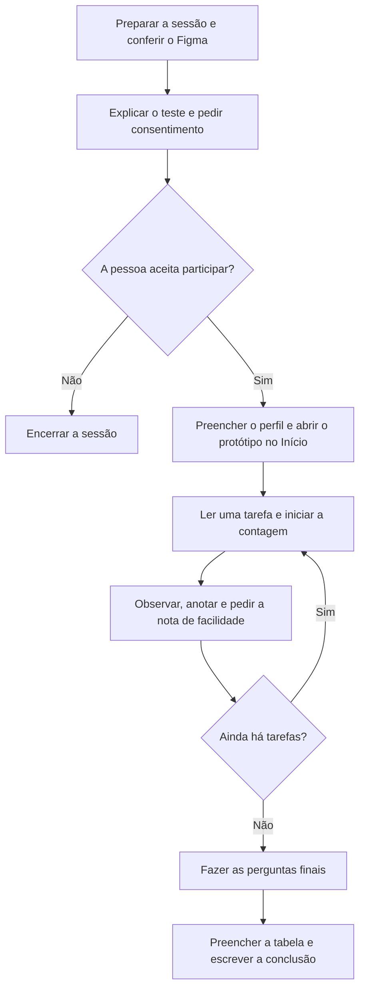

Método de Avaliação de Usabilidade por Observação do Usuário

Como o projeto é individual, vou observar **uma pessoa**, conforme o template. Vou usar as tarefas e os instrumentos do [documento 11](11_planejamento_avaliacao.md), com uma sessão em vez da amostra maior prevista no planejamento inicial.

## 1) Fluxograma de Avaliação de Usabilidade por Observação do Usuário

## 2) Descrição do procedimento de preparação do teste

**Passo 1 — Preparar a sessão.** Vou convidar uma pessoa que use carro alugado para trabalhar, em nome próprio ou pela empresa. Vou abrir o [protótipo do Figma](10_prototipacao_figma.md) no celular e conferir os caminhos antes da sessão. Vou usar o Fiat Argo e os registros fictícios já montados.

**Passo 2 — Listar as tarefas.** Vou começar no **Início**, com o veículo já vinculado. Vou ler uma situação de cada vez e deixar a pessoa decidir onde tocar.

| Tarefa | O que vou pedir | O que vou observar |
| --- | --- | --- |
| **T1 — Consultar a revisão** | Descubra quando vence a próxima revisão. | Se localiza e informa a data correta. |
| **T2 — Solicitar manutenção** | Peça um dia e horário para a revisão. Depois diga se já pode contar com esse horário. | Se envia o pedido e entende que a confirmação depende da locadora. |
| **T3 — Abrir chamado** | Você ouviu um barulho ao frear. Avise a locadora pelo aplicativo. | Se chega ao envio, diz qual relato registraria e explica se entendeu o retorno à lista. |
| **T4 — Acompanhar chamado** | Veja se a locadora está cuidando do chamado do barulho ao frear e se já existe alguma orientação. | Se localiza o chamado e distingue o status da orientação que estiver disponível. |
| **T5 — Consultar o histórico** | Encontre a data de abertura da ordem de serviço do barulho ao frear. | Se abre a OS correspondente e identifica a data de abertura. |

**Passo 3 — Preencher o perfil do usuário.** Vou usar um código para a pessoa e anotar se o carro foi alugado em nome próprio ou pela empresa, com que frequência ela dirige e como acompanha a manutenção hoje.

**Passo 4 — Explicar a sessão e pedir consentimento.** Vou avisar que estou avaliando as telas e que a pessoa pode parar quando quiser. Se houver gravação, vou pedir uma autorização específica para gravar a tela e a voz.

**Passo 5 — Observar e registrar.** Vou cronometrar cada tarefa a partir do fim da leitura até a conclusão ou o abandono. Vou anotar os erros quando ocorrerem e marcar qualquer ajuda que eu der. Ao fim de cada tarefa, vou perguntar quão fácil foi realizá-la, de **1** (muito difícil) a **5** (muito fácil). Depois, vou aplicar as perguntas finais do documento 11.

## 3) Resultados do teste

Não consegui para funcionários e motoristas para realizarem o teste do aplicativo após montagem completa.
