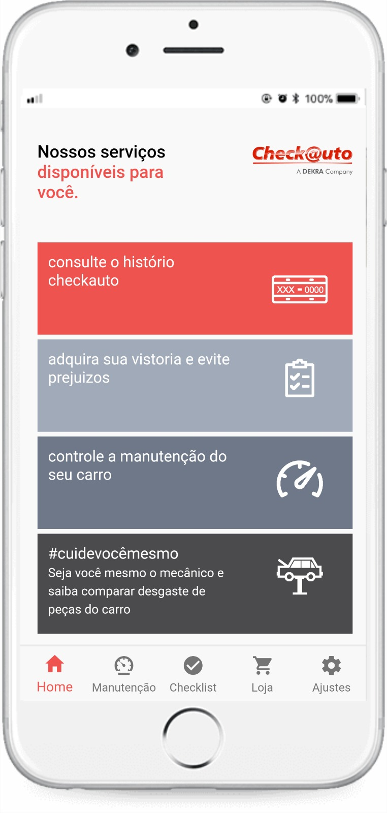
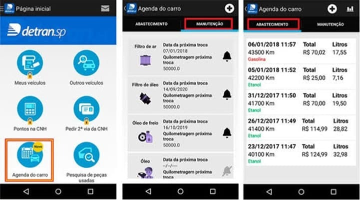
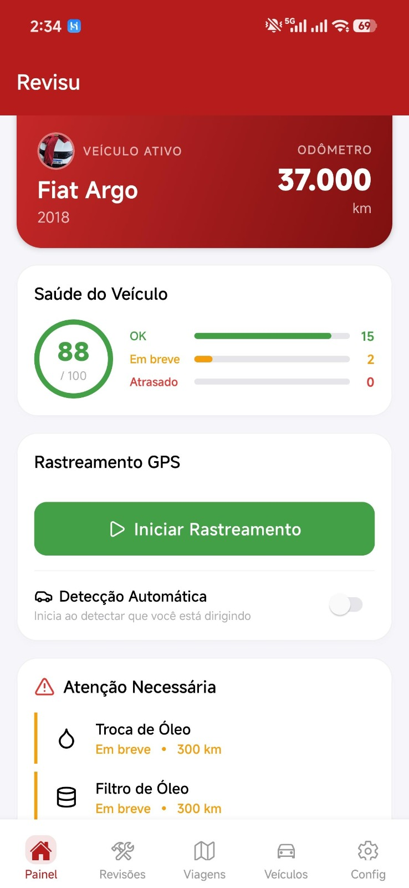

# Análise de concorrência

**Projeto:** manutenção de veículos alugados por motoristas de aplicativo.  
**Recorte:** planejar revisões, comunicar problemas à locadora e recuperar os registros na devolução.  

## 1. Concorrentes e interfaces de referência

Para o meu projeto, selecionei três interfaces com funções ligadas à manutenção de veículos. Usei as capturas para comparar como cada tela apresenta informações e ações. Ainda preciso confirmar com os motoristas quais ferramentas eles mais usam no dia a dia.

### Checkauto — serviços, vistoria e histórico

Na tela inicial do Checkauto, vejo atalhos para histórico, vistoria e manutenção. Essa captura me ajuda a estudar como apresentar várias tarefas sem esconder as mais importantes do usuário.

### Detran.SP — Agenda do Carro

A Agenda do Carro aparece como um atalho na tela inicial. Usei essa referência para observar como a lista de manutenção apresenta data e quilometragem por item.

### Revisu — painel de manutenção preventiva

Na Revisu, o painel reúne veículo, odômetro e avisos de revisão. Usei essa tela como referência para pensar no que o motorista precisa ver logo ao abrir o meu aplicativo sem se complicar muito.

## 2. Características e funcionalidades

| Referência | O que observei |
| --- | --- |
| **Checkauto** | Cartões para histórico, vistoria, manutenção e orientação sobre desgaste de peças. O menu inferior tem acessos para início, manutenção, checklist, loja e ajustes. |
| **Agenda do Carro** | Atalho na tela inicial e abas de manutenção e abastecimento. Os itens de manutenção mostram data, quilometragem da próxima troca e um ícone de sino. Os registros de abastecimento exibem data, quilometragem, valor e litros. |
| **Revisu** | Veículo ativo, odômetro, resumo das revisões e avisos com situação e quilômetros restantes. Há também uma área de rastreamento. |

## 3. Preços e modelos de negócio

O aplicativo do Detran é um aplicativo 100% gratuito, o CheckAuto não consegui encontrar e nem identificar valores abertos ao publico direto, já o Revisu, possui assinaturas mensais nos valores de R$19,90 ou R$119,90 anual.

## 4. Padrões e tendências observados

- **Entradas por tarefa.** Checkauto e Detran.SP usam opções em destaque na tela inicial. O Revisu usa painel e navegação inferior. Para o projeto, vale testar quais tarefas precisam estar visíveis no primeiro acesso.
- **Prazo no contexto do veículo.** A Agenda do Carro mostra data e quilometragem por item. O Revisu aproxima os avisos do odômetro atual e indica quanto falta. Isso sugere reunir prazo, situação e próxima ação.
- **Status reconhecível.** A Agenda do Carro usa ícones. O Revisu combina cor e texto, como “Em breve” e “Atrasado”. Para o projeto, a situação deve ser compreensível mesmo sem distinguir as cores.
- **Quilometragem em destaque.** O painel do Revisu mostra o odômetro e uma opção de rastreamento. No meu projeto, quero investigar de onde vem a quilometragem e quando o motorista precisa atualizá-la.

## 5. Síntese dos resultados

| Referência | Ponto positivo | Limitação observada ou ponto a investigar |
| --- | --- | --- |
| **Checkauto** | Cartões grandes combinam ícone e texto. Manutenção e checklist têm entradas explícitas. | A manutenção divide espaço com outros serviços. A próxima revisão não aparece na captura da tela inicial. |
| **Agenda do Carro** | Data e quilometragem ficam lado a lado por item, o que ajuda a comparar os prazos. | A agenda é uma opção entre vários serviços. O texto da lista é compacto e a diferença entre estados do sino exige interpretação. |
| **Revisu** | Veículo, odômetro e avisos têm rótulos claros; o estado é comunicado por texto e cor. | O rastreamento ocupa bastante espaço antes dos avisos. A captura mostra a nota de saúde sem explicar como ela foi calculada. |

As três referências ajudam principalmente a pensar na **manutenção preventiva**. Nas capturas, não encontrei a sequência de **relatar um problema à locadora, acompanhar a resposta e recuperar o registro na devolução**.

## 6. Recomendações para o projeto

Para o meu aplicativo, proponho testar as seguintes decisões:

1. **Dar acesso direto às duas tarefas centrais.** Exibir a próxima manutenção e a ação **Reportar problema** no painel do veículo. Testar se o motorista encontra os dois caminhos sem instrução.
2. **Confirmar o envio do chamado e mostrar seu andamento.** Exibir confirmação, identificação do chamado e próxima orientação disponível. Investigar com a locadora quais situações correspondem ao atendimento real.
3. **Organizar o histórico da locação.** Reunir revisões, chamados e respostas em ordem cronológica. Validar com motoristas se fotos, comprovantes e filtros ajudam a recuperar registros na devolução.
4. **Verificar o uso real de aplicativos e canais.** Pedir que motoristas e locadoras descrevam como agendaram a última revisão ou registraram o último problema. Usar os relatos para confirmar quais ferramentas merecem ser investigadas em seguida.
