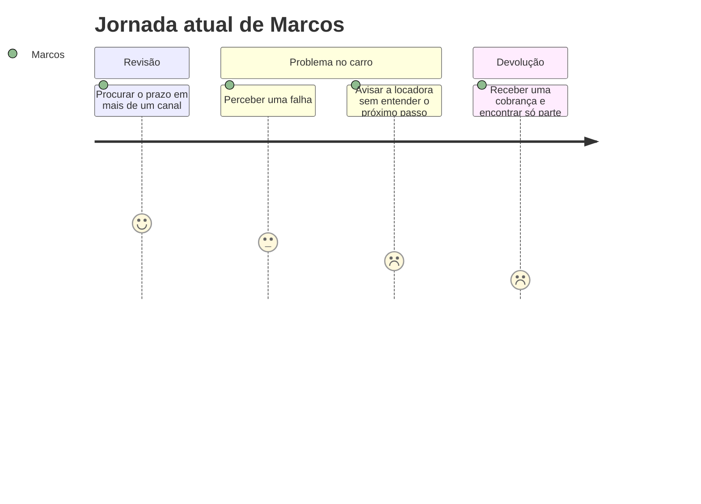
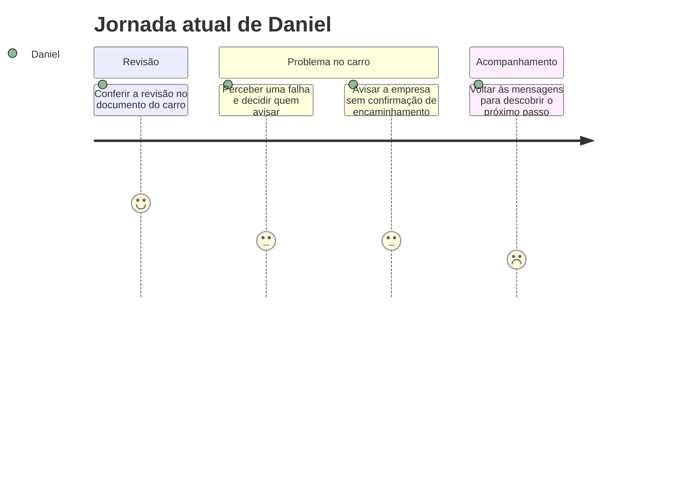

# Cenário de Análise/Problema

Usei o [perfil do usuário](3_perfil_usuario.md) e os [mapas de empatia](4_personas.md) para montar uma jornada atual para cada persona primária. As histórias combinam situações da coleta. A sequência e as emoções são hipóteses, porque o formulário não acompanhou a rotina de uma pessoa do início ao fim.

## 1) Cenário de Análise/Problema

**Marcos — motorista de aplicativo.** Antes de começar a rodar, Marcos tenta descobrir quando precisa fazer a revisão do carro alugado. Ele olha o documento do carro e procura a informação no canal da locadora, mas ainda fica em dúvida sobre o prazo. Em outro dia, percebe um problema e fala direto com a locadora. Depois de avisar, não sabe qual é o próximo passo. Na devolução, recebe uma cobrança que não esperava e encontra só parte dos registros quando tenta entender o que aconteceu.

**Daniel — funcionário que usa carro alugado.** Daniel usa um carro alugado a serviço da empresa. Quando precisa conferir a próxima revisão, procura a informação no documento do carro. Em outra saída, percebe um problema e comunica à equipe da empresa. Ele fica sem saber se alguém já falou com a locadora ou se ainda precisa fazer alguma coisa. Quando precisa retomar o assunto, volta às mensagens para tentar descobrir quem ficou responsável.

## 2) Questões de Refinamento

| Persona | O que ainda preciso entender |
| --- | --- |
| **Marcos** | Por que o prazo fica difícil de encontrar? A dúvida acontece também quando a locadora informa a data? Depois de avisar sobre um problema, que retorno ele recebe? Quais registros fizeram falta na devolução? |
| **Daniel** | Como ele decide se deve avisar a empresa ou a locadora? Quem assume o atendimento quando a empresa recebe o aviso? Como ele confirma o encaminhamento? O que já tentou fazer quando não recebeu uma orientação clara? |

## 3) Refinamento do Cenário de Análise/Problema

**Marcos.** Marcos consegue falar direto com a locadora, mas a comunicação inicial não resolve a dúvida sobre o que ele precisa fazer em seguida. Quando chega a devolução e aparece uma cobrança inesperada, ele consegue recuperar apenas parte dos registros. Usei como base três achados: os **4 motoristas** avaliaram a busca pelo prazo da revisão como “mais ou menos” ou “difícil”; dos **2** que avisaram diretamente a locadora, **1** ficou sem saber o que fazer; e, entre os **2** que relataram cobrança inesperada, **1** encontrou só parte dos registros. Ainda não sei quais registros faltaram nem se essas situações ocorreram juntas para a mesma pessoa.

**Daniel.** Daniel avisa a equipe da empresa. Quando volta às mensagens, consegue localizar o aviso que fez, mas ainda não sabe se alguém o encaminhou à locadora. Esse cenário usa um dos dois caminhos que apareceram na coleta: entre os **5 funcionários**, **2** avisaram sobre um problema, um diretamente à locadora e o outro pela empresa. A falta de confirmação é a hipótese que quero validar. A coleta não esclarece quem recebe o aviso dentro da empresa nem como o funcionário acompanha a resposta.

## 4) Contexto de Uso

| Aspecto | Marcos | Daniel |
| --- | --- | --- |
| **Ambiente e momento** | No celular, com o carro parado, antes de iniciar as corridas ou em uma pausa. | No celular ou com o documento do carro em mãos, antes ou depois de um deslocamento a serviço. |
| **Contexto social e de trabalho** | Ele fala com a locadora e precisa encaixar a revisão na rotina de corridas. | Ele cuida do carro que usa no trabalho e, dependendo do caso, precisa passar o aviso pela empresa. |
| **Canais e informações** | WhatsApp ou ligação, app ou site da locadora e documento do carro apareceram na coleta. Para entender o caso, importam o prazo informado, o que foi comunicado e a resposta recebida. | A coleta mostrou consultas em mais de um canal, inclusive com a equipe da empresa. Para entender o caso, importa saber a quem ele avisou e se alguém confirmou o encaminhamento. |
| **Impacto na rotina** | A dúvida sobre a revisão ou o atendimento pode atrapalhar a organização das corridas. | A falta de retorno pode dificultar o planejamento do próximo deslocamento a serviço. |

Os locais, horários e impactos acima são possibilidades de uso que vou validar. A coleta não mediu perdas de renda ou tempo parado.

## 5) Jornada do Usuário — situação atual

As notas de **1 (péssimo) a 9 (ótimo)** representam como cada persona pode se sentir no cenário.

### Marcos — motorista de aplicativo

| Etapa | O que acontece hoje | Estado emocional |
| --- | --- | --- |
| 1. Procurar a revisão | Consulta o documento do carro e busca o prazo no canal da locadora. | Dúvida — **4** |
| 2. Perceber um problema | Em outro momento, nota uma falha e precisa decidir como avisar. | Preocupação — **3** |
| 3. Avisar a locadora | Entra em contato direto, mas não entende o que acontece em seguida. | Insegurança — **2** |
| 4. Conferir a devolução | Recebe uma cobrança inesperada e encontra só parte dos registros ao tentar entendê-la. | Frustração — **1** |

### Daniel — funcionário que usa carro alugado

| Etapa | O que acontece hoje | Estado emocional |
| --- | --- | --- |
| 1. Conferir a revisão | Consulta o documento do carro antes de um deslocamento a serviço. | Atenção — **5** |
| 2. Perceber um problema | Nota uma falha e precisa decidir se fala com a empresa ou com a locadora. | Dúvida — **3** |
| 3. Avisar a empresa | Envia o relato à equipe, mas ainda não sabe se chegou à locadora. | Incerteza — **3** |
| 4. Buscar um retorno | Volta às mensagens para descobrir quem ficou com o caso e o que precisa fazer. | Frustração — **2** |

