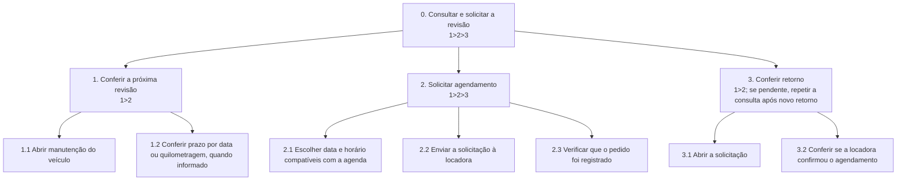
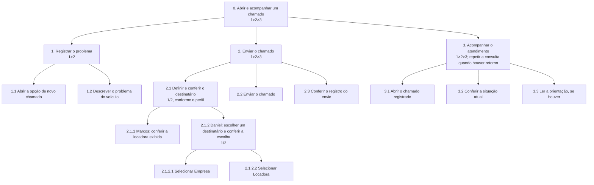

# Análise de Tarefas

Escolhi as duas tarefas que mais apareceram na definição do projeto: **consultar e solicitar a manutenção preventiva** e **abrir e acompanhar um chamado corretivo**. Usei as [jornadas de Marcos e Daniel](5_cenarios.md) para definir o que cada um precisa conseguir fazer. Aqui descrevo os fluxos propostos para o aplicativo.

| Tarefa principal | Funcionalidades analisadas |
| --- | --- |
| **1. Consultar e solicitar a manutenção preventiva** | Consultar a próxima revisão; solicitar agendamento e verificar a confirmação. |
| **2. Abrir e acompanhar um chamado corretivo** | Registrar um problema no carro; consultar o andamento e o próximo passo. |

Modelei cada tarefa com **HTA**, **GOMS-CMN** e **CTT**, conforme a atividade do PDF 3. Escolhi o CMN porque ele permite descrever a sequência de ações e diferenciar os caminhos quando a persona ou a situação muda. Cadastro e login ficam fora destas duas tarefas.

## 1) Consultar e solicitar a manutenção preventiva

**Funcionalidade:** consultar o prazo registrado da próxima revisão, solicitar uma data e horário pelo aplicativo e consultar a resposta da locadora. Para Marcos, o horário precisa caber na rotina de corridas. Para Daniel, precisa caber na agenda de deslocamentos da empresa. Nos dois casos, a locadora confirma o agendamento.

### HTA



O pedido registrado confirma o envio. O horário só fica confirmado quando a locadora responde. Marcos e Daniel executam os mesmos passos; o que muda é a agenda que cada um leva em conta para escolher o horário.

### GOMS — CMN

**Funcionalidade modelada:** localizar o prazo, enviar o pedido e conferir o retorno em uma consulta posterior.

```text
GOAL 0: consultar e solicitar a revisão do carro alugado

  GOAL 1: encontrar o prazo da próxima revisão
    METHOD 1.A: consultar a manutenção do veículo
      OP. 1.A.1: tocar em Manutenção
      OP. 1.A.2: localizar a próxima revisão
      OP. 1.A.3: ler a data ou a quilometragem informada

  GOAL 2: enviar um pedido de agendamento
    METHOD 2.A: solicitar um horário compatível com as corridas
    (SEL. RULE: o veículo é usado para trabalhar por aplicativo, como no caso de Marcos)
      OP. 2.A.1: tocar em Solicitar agendamento
      OP. 2.A.2: identificar uma janela entre as corridas ou fora do turno
      OP. 2.A.3: selecionar a data e o horário desejados
      OP. 2.A.4: tocar em Enviar solicitação
      OP. 2.A.5: verificar que o pedido foi registrado

    METHOD 2.B: solicitar um horário compatível com a agenda de serviço
    (SEL. RULE: o veículo é usado a serviço da empresa, como no caso de Daniel)
      OP. 2.B.1: tocar em Solicitar agendamento
      OP. 2.B.2: verificar quando o carro não está previsto para um deslocamento a serviço
      OP. 2.B.3: selecionar a data e o horário desejados
      OP. 2.B.4: tocar em Enviar solicitação
      OP. 2.B.5: verificar que o pedido foi registrado

  GOAL 3: conferir a confirmação da locadora
    METHOD 3.A: consultar o pedido
      OP. 3.A.1: abrir a solicitação registrada
      OP. 3.A.2: ler a situação do pedido
      OP. 3.A.3: se confirmado, conferir a data e o horário
```

### CTT

**Funcionalidade modelada:** distinguir as ações do usuário, as interações com o aplicativo e os registros que o sistema faz.

| Tarefa pai | Decomposição e relação |
| --- | --- |
| **A0** — Consultar e solicitar revisão | `A1 >> A2 >> A3` |
| **A1** — Consultar prazo | `I1` abrir manutenção `[]>> S1` localizar prazo registrado `[]>> I2` conferir prazo exibido. |
| **A2** — Enviar solicitação | `(U1 [] U2) >> I3 []>> S2 []>> I4`. `U1`: Marcos consulta sua agenda de corridas; `U2`: Daniel consulta a agenda de serviço; `I3`: selecionar e enviar o horário; `S2`: registrar o pedido; `I4`: verificar o registro. |
| **A3** — Conferir retorno | `I5 []>> S3 []>> I6`. `I5`: abrir a solicitação; `S3`: recuperar a situação; `I6`: verificar se a locadora confirmou. A locadora responde fora da sessão de quem solicitou. |

**Legenda:** `A` tarefa abstrata; `U` ação fora do aplicativo; `I` interação; `S` tarefa do sistema. `>>` indica sequência; `[]>>`, passagem de informação; `[]`, escolha de um caminho.

## 2) Abrir e acompanhar um chamado corretivo

**Funcionalidade:** registrar um problema no veículo, confirmar o envio e voltar ao chamado para saber quem está atendendo e qual é o próximo passo. A confirmação de envio e o andamento são os mesmos objetivos para as duas personas.

**Fluxo comum:** abrir a opção de chamado → descrever o problema → conferir e enviar → verificar o registro → reabrir o chamado para consultar a situação e a orientação disponível.

**Diferença por persona:** Marcos vê a locadora como destinatário. Daniel escolhe entre **Empresa** e **Locadora** e confere sua escolha antes do envio.

### HTA

**Funcionalidade modelada:** registrar o problema, verificar se o envio foi registrado e consultar o chamado mais tarde.



### GOMS — CMN

**Funcionalidade modelada:** preencher e enviar o relato, depois encontrar a situação e a orientação do atendimento.

```text
GOAL 0: abrir e acompanhar um chamado do veículo alugado

  GOAL 1: descrever o problema
    METHOD 1.A: preencher o chamado
      OP. 1.A.1: tocar em Novo chamado
      OP. 1.A.2: tocar no campo de descrição
      OP. 1.A.3: digitar o que aconteceu

  GOAL 2: enviar o chamado ao destinatário correto
    METHOD 2.A: enviar à locadora (caminho de Marcos)
    (SEL. RULE: o usuário é Marcos e a locadora já aparece como destinatário)
      OP. 2.A.1: ler o destinatário exibido
      OP. 2.A.2: tocar em Enviar chamado
      OP. 2.A.3: verificar a confirmação de registro

    METHOD 2.B: enviar à empresa (caminho de Daniel)
    (SEL. RULE: Daniel quer avisar a empresa)
      OP. 2.B.1: tocar no seletor de destinatário
      OP. 2.B.2: selecionar Empresa
      OP. 2.B.3: conferir a opção exibida
      OP. 2.B.4: tocar em Enviar chamado
      OP. 2.B.5: verificar a confirmação de registro

    METHOD 2.C: enviar diretamente à locadora (caminho de Daniel)
    (SEL. RULE: Daniel quer avisar a locadora diretamente)
      OP. 2.C.1: tocar no seletor de destinatário
      OP. 2.C.2: selecionar Locadora
      OP. 2.C.3: conferir a opção exibida
      OP. 2.C.4: tocar em Enviar chamado
      OP. 2.C.5: verificar a confirmação de registro

  GOAL 3: verificar o andamento
    METHOD 3.A: consultar o chamado registrado
      OP. 3.A.1: tocar em Chamados
      OP. 3.A.2: localizar o chamado na lista
      OP. 3.A.3: tocar no chamado
      OP. 3.A.4: ler a situação atual
      OP. 3.A.5: se houver orientação, ler o próximo passo
```

### CTT

**Funcionalidade modelada:** separar o envio pelo usuário, o registro pelo sistema e a consulta ao retorno.

| Tarefa pai | Decomposição e relação |
| --- | --- |
| **B0** — Abrir e acompanhar chamado | `B1 >> B2 >> B3` |
| **B1** — Registrar problema | `I1 >> I2`. `I1`: abrir um novo chamado; `I2`: informar a descrição. |
| **B2** — Enviar chamado | `B2.1 >> I4 []>> S1 []>> I5`. `I4`: enviar; `S1`: registrar o chamado com o destinatário; `I5`: conferir a confirmação. |
| **B2.1** — Definir e conferir o destinatário | `I3 [] ((I8 [] I9) >> I10)`. `I3`: Marcos confere a locadora exibida; `I8`: Daniel seleciona Empresa; `I9`: Daniel seleciona Locadora; `I10`: Daniel confere sua escolha. |
| **B3** — Consultar andamento | `I6 []>> S2 []>> I7`. `I6`: abrir o chamado; `S2`: recuperar a situação e a orientação disponível; `I7`: ler o retorno. |
