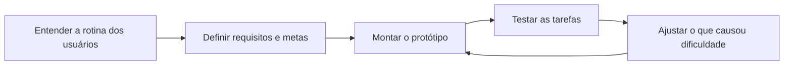

# Requisitos de UX e Metas de Usabilidade

Neste documento, defini o que o aplicativo precisa fazer para Marcos e Daniel e como vou verificar se eles conseguem usar os dois fluxos principais. Vou partir das [dificuldades encontradas na pesquisa](3_perfil_usuario.md) e das [tarefas do documento 6](6_analise_tarefas.md).

## 1) Características da Plataforma

| Característica | Descrição |
| --- | --- |
| **Software** | Vou prototipar um aplicativo web responsivo, começando pelo celular. As áreas principais serão manutenção preventiva, chamados e histórico do veículo. |
| **Hardware** | O principal dispositivo é o celular, usado com o carro parado. Também vou conferir se o protótipo se adapta a tablet e notebook, conforme a atividade da disciplina. |
| **Capacidades** | Mostrar o prazo da revisão quando houver informação cadastrada; solicitar um horário e consultar a confirmação da locadora; registrar um problema, verificar o envio e consultar o andamento e o histórico. |
| **Restrições** | A solicitação de revisão não confirma o horário por si só. O retorno depende da locadora. Se o envio falhar, o usuário precisa saber que o pedido ou chamado não foi registrado. No protótipo, posso representar esses estados sem depender de uma integração real. |

## 2) Princípios Gerais do Projeto

| Princípio | Como vou aplicar | Base no projeto |
| --- | --- | --- |
| **Contexto de uso** | Vou colocar a próxima revisão e o acesso a chamados em destaque. Marcos precisa encaixar a revisão na rotina de corridas; Daniel precisa conciliá-la com os deslocamentos da empresa. | [Cenários e jornadas](5_cenarios.md) |
| **Privacidade — LGPD, citada no template** | Vou pedir apenas os dados necessários para a tarefa. O histórico deve ficar visível a quem precisa consultar aquele veículo ou chamado. | [Cuidados adotados na pesquisa](2_pesquisa_usuarios.md) |
| **Acessibilidade — Lei da Acessibilidade, citada no template** | Vou usar texto para informar o estado de cada pedido, sem depender só de cor. Também vou conferir o contraste, o foco visível e a navegação por teclado.
| **Usabilidade — ABNT NBR ISO 9241, citada no template** | Vou testar se as pessoas conseguem concluir as tarefas e explicar o que aconteceu depois de cada ação. Os resultados vão orientar os ajustes do protótipo. | [Análise de tarefas](6_analise_tarefas.md) |
| **Clareza do retorno** | Vou diferenciar um pedido enviado de um horário confirmado. Nos chamados, quero mostrar a situação atual e a orientação disponível. | [Necessidades da pesquisa](3_perfil_usuario.md) |

## 3) Metas de Usabilidade

### 3.1) Qualitativas

- **Encontrar a próxima revisão:** a pessoa deve localizar o prazo e conseguir explicar se precisa olhar uma data, uma quilometragem ou as duas informações.
- **Entender o agendamento:** depois de solicitar um horário, a pessoa deve saber se ainda está esperando a locadora ou se já pode se organizar para levar o carro.
- **Registrar um problema com segurança:** ao enviar o chamado, a pessoa deve saber se o registro foi feito. Se o envio falhar, a mensagem deve indicar como tentar de novo.
- **Entender o próximo passo:** ao voltar ao chamado, a pessoa deve conseguir dizer qual é a situação e o que precisa fazer. Se ainda não houver orientação, isso deve aparecer com clareza.
- **Recuperar um registro na devolução:** a pessoa deve conseguir voltar a um chamado antigo e consultar o que foi informado sobre aquele problema.

### 3.2) Quantitativas

A coluna **Peso** mostra a importância de cada meta na avaliação e soma **100%**. A coluna **Meta de teste** mostra o desempenho que quero alcançar. São metas propostas para o protótipo; ainda não são resultados medidos.

| Meta | Peso | Meta de teste | Justificativa |
| --- | ---: | --- | --- |
| **Localizar o prazo da revisão** | 25% | Pelo menos **80%** localizam a próxima revisão e identificam o prazo correto, sem ajuda. | Na pesquisa, **6 de 10** avaliaram a busca pelo prazo como “mais ou menos” ou “difícil”. |
| **Solicitar um horário e entender a confirmação** | 20% | Pelo menos **80%** registram a solicitação e dizem corretamente se o horário ainda está pendente ou já foi confirmado. | Quero evitar que a pessoa organize seu dia contando com um horário que a locadora ainda não confirmou. |
| **Registrar e enviar um chamado** | 20% | Pelo menos **80%** descrevem o problema, conferem o destinatário correto para o cenário, enviam o chamado e identificam a confirmação de registro sem ajuda. | Entre as **6 pessoas** que relataram um problema, **2** não o comunicaram. A pesquisa não explicou por quê; o teste vai mostrar se o fluxo proposto é claro. |
| **Consultar o andamento e identificar o próximo passo** | 25% | Pelo menos **80%** localizam um chamado existente e explicam sua situação e a orientação disponível, sem ajuda. | Entre as **4 pessoas** que comunicaram um problema, **2** disseram que entender o próximo passo foi “mais ou menos”, **1** ficou sem saber o que fazer e **1** não lembrava. |
| **Recuperar um registro no histórico** | 10% | Pelo menos **80%** encontram o chamado indicado no cenário e identificam a data do registro. | Das **3 pessoas** que relataram cobrança, **2** encontraram só parte dos registros de que precisavam. |
| **Total** | **100%** | | |

No teste, vou dar uma situação para cada participante e observar a execução sem indicar onde tocar. Se, por exemplo, cinco pessoas fizerem uma tarefa, **80% corresponde a quatro conclusões**. Vou registrar também quando alguém confundir **pedido enviado** com **horário confirmado**, mesmo que tenha conseguido concluir as outras etapas.

O chamado de Marcos segue direto para a locadora. Daniel escolhe entre **Empresa** e **Locadora**. No teste, vou verificar se Marcos reconhece para onde o relato vai e se Daniel consegue selecionar e conferir o destinatário indicado no cenário.
