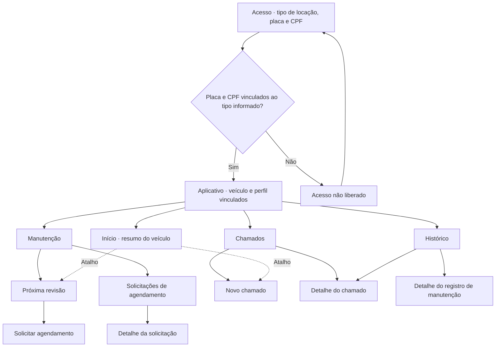
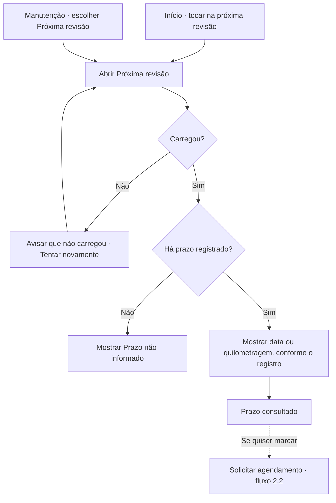
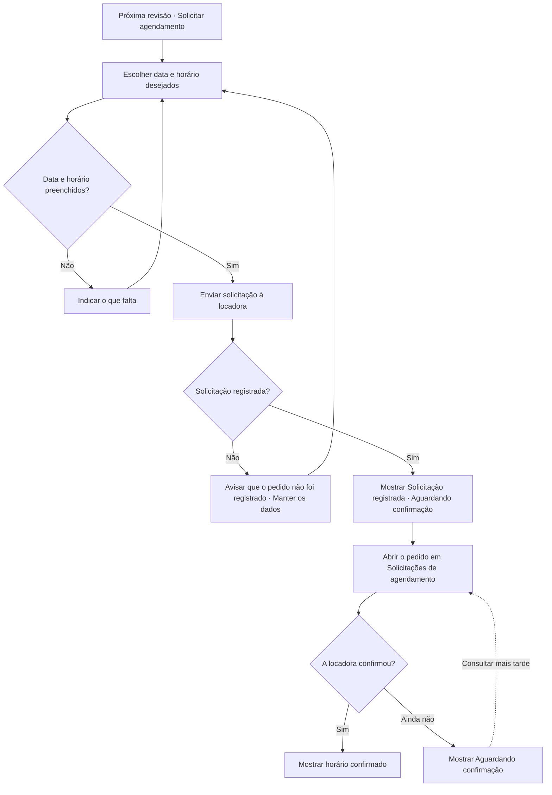
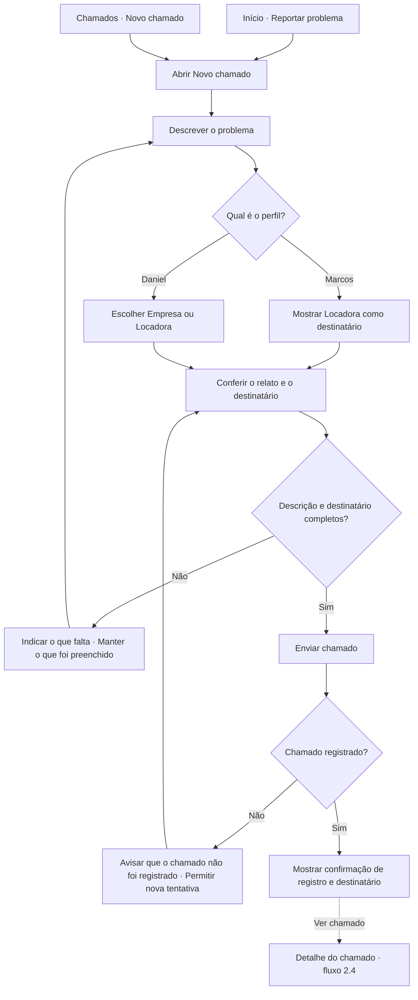
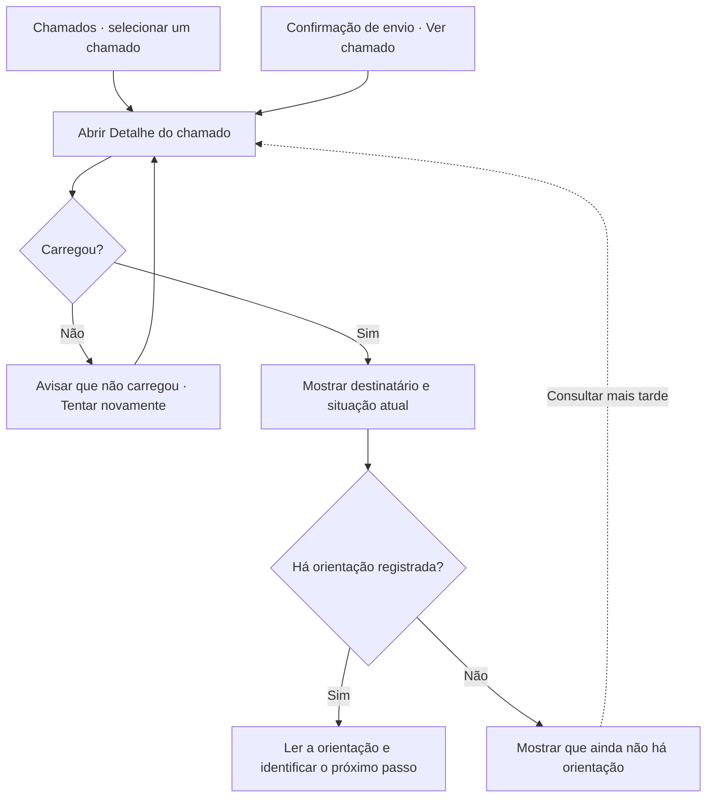
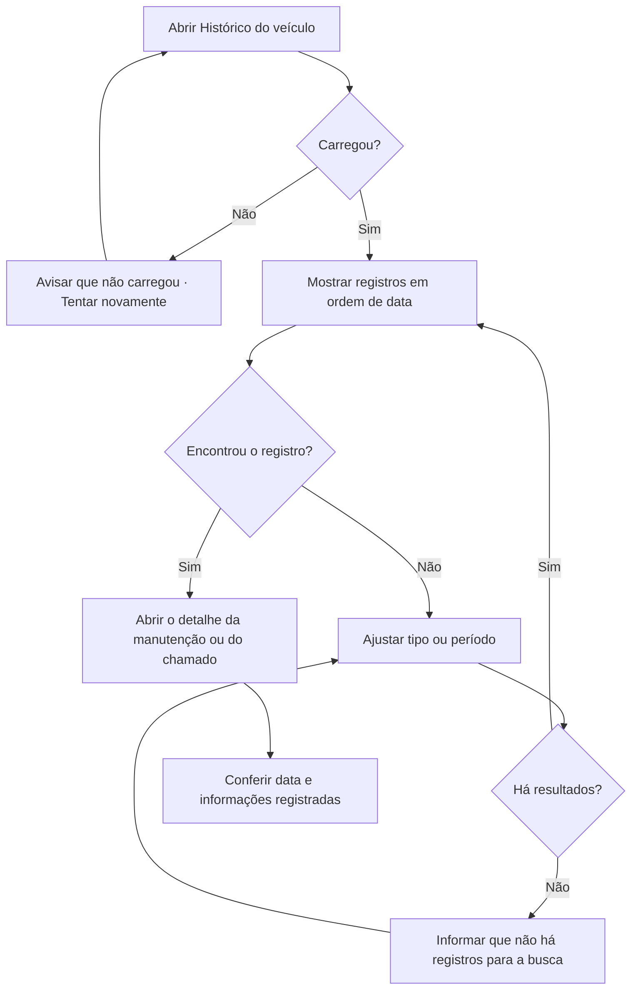

# Arquitetura de Informação e Fluxo do Usuário

Organizei as telas a partir das [tarefas principais](6_analise_tarefas.md) e das [metas de usabilidade](7_requisitos_ux.md). Quero que Marcos e Daniel consigam ver quando é a próxima revisão, avisar sobre um problema e encontrar o retorno sem precisar procurar em vários lugares.

## 1) Arquitetura de Informação (Sitemap)

| Área | O que vou mostrar |
| --- | --- |
| **Acesso** | Seleção **PF** (locação em nome próprio) ou **PJ** (carro alugado pela empresa), seguida de placa e CPF do motorista nos dois casos. O registro fictício da locadora confirma o vínculo, o veículo e o perfil. Com os dados correspondentes, a pessoa entra no **Início**; sem vínculo, fica na entrada. |
| **Início** | Veículo em uso, resumo da próxima revisão e atalho **Reportar problema**. |
| **Manutenção** | Prazo da próxima revisão, formulário de solicitação e lista de pedidos com a situação de cada um. |
| **Chamados** | Ação **Novo chamado**, lista e detalhe com destinatário, situação e orientação disponível. |
| **Histórico** | Registros da locação por data. A tela abre o detalhe da manutenção ou o mesmo detalhe do chamado que já existe em **Chamados**. |

Coloquei a revisão e o atalho de chamado no **Início** porque foram pontos de dificuldade na pesquisa. Separei **Chamados** de **Histórico** para facilitar dois usos: acompanhar um atendimento agora e recuperar um registro mais tarde, por exemplo na devolução. As duas áreas levam ao mesmo detalhe quando mostram o mesmo chamado.

## 2) Fluxo do Usuário (User Flow)

### 2.1) Consultar a próxima revisão

**Objetivo:** Marcos e Daniel querem saber quando precisam fazer a revisão. Os dois podem tocar no resumo do **Início** ou entrar pela área **Manutenção**.

### 2.2) Solicitar agendamento e verificar a confirmação

**Objetivo:** solicitar um horário e saber se a locadora confirmou. Marcos escolhe um horário que caiba entre as corridas; Daniel considera os deslocamentos da empresa. Os dois recebem a confirmação da locadora.

O usuário pode voltar direto à lista de solicitações. **Pedido registrado** confirma o envio; **horário confirmado** depende da locadora.

### 2.3) Abrir um chamado corretivo

**Objetivo:** registrar o que aconteceu com o carro e verificar se o chamado foi recebido pelo sistema. Marcos vê **Locadora** como destinatário. Daniel **escolhe entre Empresa e Locadora** antes de enviar.

### 2.4) Consultar o andamento do chamado

**Objetivo:** descobrir a situação atual e o que fazer em seguida. O detalhe mostra o destinatário do relato e o retorno que estiver disponível.

Se não houver chamados na lista, a tela informa isso e oferece **Novo chamado**. O atalho após o envio evita que o usuário tenha de voltar à lista para ver o chamado que acabou de abrir.

### 2.5) Recuperar um registro no histórico

**Objetivo:** encontrar a data e os detalhes de um registro anterior, por exemplo quando surge uma dúvida na devolução. O usuário pode procurar na lista ou filtrar por tipo ou período.

## Primeiros passos da prototipação

Vou começar por **Acesso** e **Início**. Em seguida, vou desenhar **Próxima revisão**, **Solicitar agendamento**, **Detalhe da solicitação**, **Novo chamado**, **Lista e detalhe de chamados** e **Histórico**. Nas primeiras versões, vou representar também os estados que fazem diferença: **acesso não liberado**, **aguardando confirmação**, **confirmado**.
