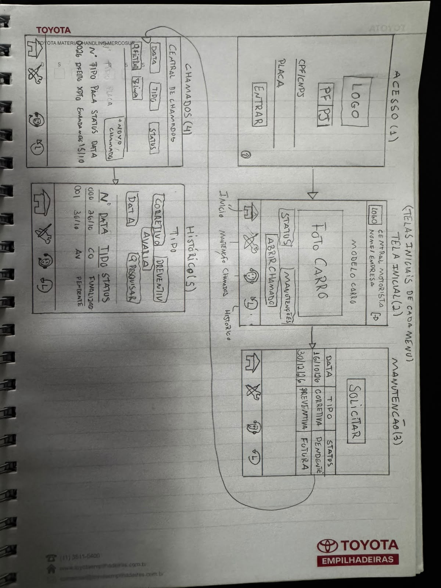
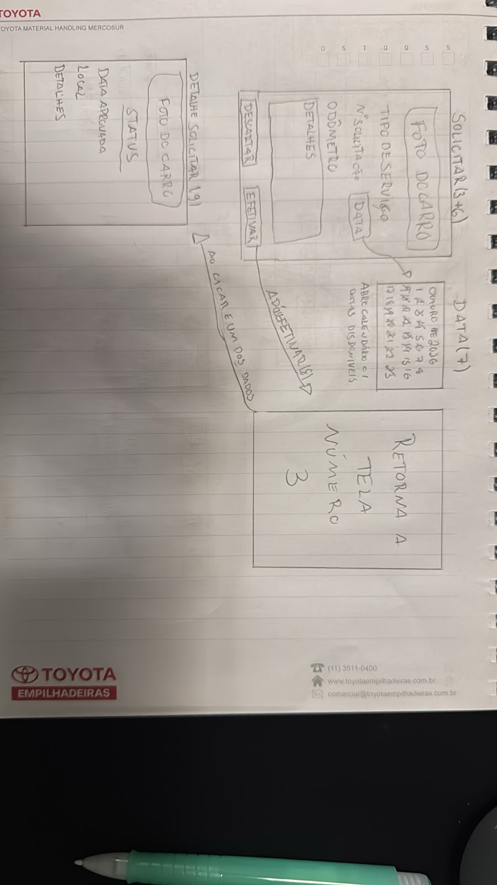
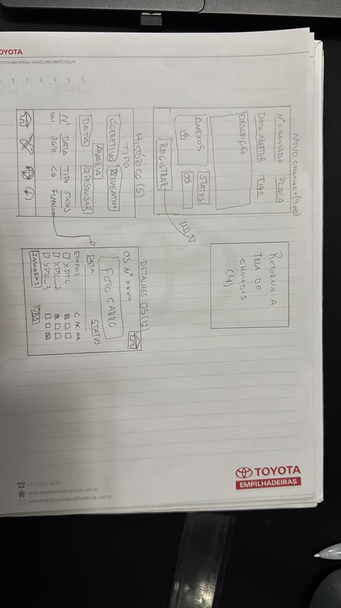

Prototipação em Papel (Lo-fi)

Desenhei o protótipo à mão para conferir se a navegação e os fluxos do [Documento 8](8_arquitetura_fluxo.md) funcionam antes de passar para a alta fidelidade.

## 1. Esboços das telas principais

Desenhei as telas de **Acesso**, **Início**, **Manutenção**, **Chamados** e **Histórico**. No acesso, Marcos escolhe **PF**, pois aluga o carro em nome próprio, e Daniel escolhe **PJ**, pois usa um carro alugado pela empresa. Nos dois casos, o acesso depende do vínculo entre a placa e o CPF/CNPJ do motorista no cadastro da locadora. Depois de entrar, os dois usam as mesmas telas.

## 2. Fluxos do usuário

- **Consultar a próxima revisão.** Na tela de **Manutenção**, o motorista consulta a data e o status da próxima manutenção preventiva.
- **Solicitar manutenção e consultar a confirmação.** Em **Manutenção**, o motorista toca em **Solicitar**, escolhe uma data no calendário e toca em **Efetivar**. O app volta para a lista. Ao tocar no pedido, ele pode conferir o status e, depois da aprovação da locadora, a data e o local.
- **Abrir um chamado corretivo.** Em **Chamados**, o motorista toca em **Novo chamado**, descreve o problema e pode incluir anexos. Ao tocar em **Registrar**, volta para a lista. A locadora recebe o chamado, gera a ordem de serviço (OS) automaticamente e define o encaminhamento.
- **Acompanhar o chamado.** O motorista confere o status na lista de **Chamados**.
- **Recuperar um registro no histórico.** O motorista pesquisa por tipo ou data e toca no registro para ver os detalhes da OS, como status, etapas, imagens e observações.

## 3. Fotos dos esboços

**Folha 1 — Acesso e telas principais**

**Folha 2 — Solicitação de manutenção**

**Folha 3 — Novo chamado e detalhes da OS**

## 4. Feedback da apresentação

Ainda não registrei feedback sobre a apresentação do protótipo
